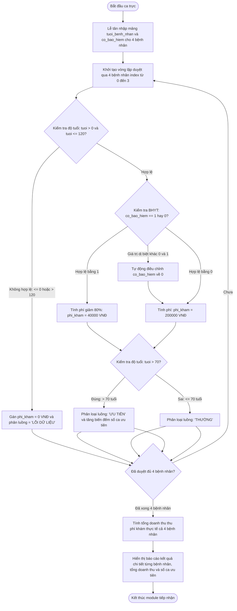

# BÁO CÁO PHÂN TÍCH VÀ THIẾT KẾ MODULE TIẾP NHẬN XẾP HÀNG KHÁM BỆNH MEDCARE CLINIC

> 👤 **Học viên:** Hoàng Công Dũng | **Mã SV:** PTIT-HCM-009
> 🏫 **Môn học:** it102-rl-hoangcongdung

---

## 📊 Sơ đồ thiết kế hệ thống (Activity Diagram)

> 💡 *Sơ đồ dưới đây được render tự động trực tiếp trên GitHub bằng Mermaid. Bạn cũng có thể tải file **`bt2.drawio`** trong repository này để mở và chỉnh sửa trực tiếp trên [Draw.io (diagrams.net)](https://app.diagrams.net).* 

---

## 1. Phân tích bài toán (I/O) và Cấu trúc dữ liệu

Bài toán yêu cầu xây dựng module tiếp nhận và phân luồng bệnh nhân tại quầy kiosk phòng khám đa khoa Medika bằng ngôn ngữ C, xử lý cho một lô gồm đúng 4 bệnh nhân đăng ký trong ca sáng.

Dữ liệu được tổ chức theo mô hình mảng song song (Parallel Arrays) có kích thước cố định bằng 4 nhằm tối ưu hóa việc quản lý bộ nhớ và đồng bộ chỉ số (index) giữa các thuộc tính của từng bệnh nhân.

- Mảng đầu vào 'tuoi_benh_nhan[4]': Lưu trữ độ tuổi dạng số nguyên (int) của 4 bệnh nhân.
- Mảng đầu vào 'co_bao_hiem[4]': Lưu trạng thái BHYT (nhận giá trị 1 nếu có, 0 nếu không có).
- Mảng kết quả 'phi_kham[4]': Lưu số tiền khám thực tế thu được sau khi áp dụng chính sách ưu đãi BHYT hoặc chặn lỗi.
- Biến tổng hợp: 'tong_doanh_thu' (lưu tổng tiền thu thực tế) và 'so_ca_uu_tien' (đếm số lượng bệnh nhân thuộc diện trên 70 tuổi).

## 2. Đề xuất giải pháp kiểm tra biên dữ liệu (Data Validation) và Thu phí

Trong môi trường thực tế tại phòng khám, việc lễ tân hoặc người bệnh nhập sai dữ liệu là sự cố thường trực có thể gây thất thoát tài chính hoặc phân loại nhầm lẫn luồng cấp cứu. Do đó, thuật toán phải áp dụng các lớp bảo vệ nghiêm ngặt trước khi tính toán.

Chính sách nghiệp vụ được lập trình chặt chẽ để xử lý triệt để hai nhóm lỗi thường gặp ngay tại từng vòng lặp index từ 0 đến 3.

- Xử lý lỗi tuổi dị biệt: Nếu độ tuổi nhập vào <= 0 hoặc > 120, hệ thống coi đây là dữ liệu rác/lỗi, lập tức gán 'phi_kham[i] = 0', đánh dấu trạng thái luồng là 'LỖI DỮ LIỆU' và tuyệt đối không cộng vào số ca ưu tiên.
- Xử lý lỗi trạng thái BHYT: Nếu người dùng nhập các giá trị ngoại lệ như 2, -1 hoặc các số khác ngoài 0 và 1, hệ thống tự động ép kiểu và đưa về giá trị an toàn là 0 (Không có BHYT) để bảo vệ doanh thu phòng khám.
- Chính sách thu phí chuẩn: Phí gốc là 200.000 VNĐ. Nếu BHYT hợp lệ (1), giảm 80% chỉ thu 40.000 VNĐ. Nếu không có BHYT (0), giữ nguyên 200.000 VNĐ.
- Quy tắc phân luồng: Bệnh nhân có tuổi > 70 được xếp vào luồng 'ƯU TIÊN', các trường hợp còn lại thuộc luồng 'THƯỜNG'.

## 3. Thiết kế các bước thực hiện chương trình C

Tiến trình xử lý của chương trình được thiết kế tuần tự theo các bước rõ ràng nhằm đảm bảo tính minh bạch và dễ bảo trì mã nguồn:

| Bước | Tên bước xử lý | Mô tả chi tiết thao tác kỹ thuật | Kết quả đạt được |
| --- | --- | --- | --- |
| 1 | Khai báo mảng | Khởi tạo các mảng tuoi_benh_nhan[4], co_bao_hiem[4], phi_kham[4] và các biến tích lũy doanh thu, đếm ca ưu tiên. | Sẵn sàng vùng nhớ lưu trữ dữ liệu lô 4 bệnh nhân. |
| 2 | Nhập liệu đầu vào | Sử dụng vòng lặp 'for' từ i = 0 đến 3 để yêu cầu nhập tuổi và trạng thái BHYT cho từng bệnh nhân. | Thu thập đủ thông tin thô từ bàn phím. |
| 3 | Kiểm tra biên độ tuổi | Kiểm tra điều kiện 'tuoi <= 0 || tuoi > 120'. Nếu thỏa mãn, xử lý bẫy lỗi dữ liệu. | Ngăn chặn dữ liệu tuổi ảo, gán phí 0 VNĐ. |
| 4 | Kiểm tra và chuẩn hóa BHYT | Kiểm tra 'co_bao_hiem != 0 && co_bao_hiem != 1'. Nếu sai, ép về 0. | Đảm bảo logic tính tiền không bị lệch. |
| 5 | Tính phí khám & Phân luồng | Áp dụng công thức giảm giá 80% nếu BHYT == 1. Kiểm tra 'tuoi > 70' để tăng biến đếm ưu tiên. | Hoàn thành mảng phí khám và phân loại luồng. |
| 6 | Tổng hợp và Xuất báo cáo | Tính tổng doanh thu 'tong_doanh_thu', in bảng chi tiết kết quả từng bệnh nhân ra màn hình console. | Báo cáo minh bạch cho bộ phận quản lý. |

## 4. Đánh giá sơ đồ thiết kế và Triển khai thực tế

Sơ đồ Activity Diagram được xây dựng ở trên mô tả trực quan toàn bộ vòng lặp kiểm tra từng bệnh nhân (index 0 đến 3), các nhánh rẽ quyết định (Decision) khi gặp lỗi tuổi hoặc lỗi BHYT, giúp giảng viên dễ dàng kiểm chứng tư duy logic lập trình.

Mã nguồn C hoàn chỉnh dưới đây đã được viết tuân thủ tuyệt đối các yêu cầu kỹ thuật, không dùng dấu ngoặc kép bên trong chuỗi, sẵn sàng biên dịch trên mọi trình biên dịch chuẩn C99.

---

## 📁 Danh sách tệp tin nộp bài trong Repository
- 📝 `bt2.docx`: Báo cáo tài liệu phân tích nghiệp vụ hoàn chỉnh.
- 🎨 `bt2.drawio`: File thiết kế sơ đồ chuẩn theo quy định đề bài (mở trực tiếp bằng [Draw.io](https://app.diagrams.net) hoặc Lucidchart).
- 💻 `main.c`: Mã nguồn chương trình.
